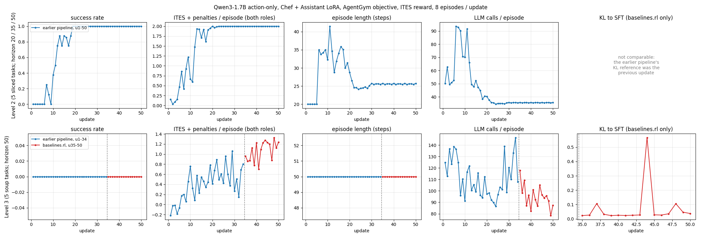

# SFT and RL baselines

Training baselines for small open models (Qwen3-1.7B) on Collab-Overcooked v2. Each role (Chef, Assistant) is a
LoRA adapter (r=16, alpha=32 on q/k/v/o) of the same base model. The agents, prompts and validation are the
benchmark's own (`collab_overcooked.agent_factory.make_agent`); the model is plugged in through the
[Extension API](../docs/extension_api.md), so training sees exactly the prompts used in evaluation.

Two response formats (`response_protocol`): `action_only` (a single `Action:` field) and `think_action`
(`Think` / `Recent Goal` / `Action`). Use the same format for the SFT data, SFT, RL and evaluation.

Extra requirements: `peft`, and vLLM for RL (tested with 0.18; it may live in a separate environment, see `vllm_python`).

## Shared data and checkpoints on the lab server

Readable by the `cistusers` group:

| What | Path |
|---|---|
| Base model (Qwen3-1.7B) | `/datacache/huggingface/hub/models--Qwen--Qwen3-1.7B/snapshots/70d244cc86ccca08cf5af4e1e306ecf908b1ad5e` |
| SFT data, action only | `/datacache/collab_overcooked/sft_data/gpt4o_action_only_v2_l123/` |
| SFT data, with Think | `/datacache/collab_overcooked/sft_data/gpt4o_clean_v2_l123/` |
| SFT adapters, action only, Level 1-2 data (start of the RL runs below) | `/datacache/collab_overcooked/sft_checkpoints/action_only_l12/{Chef,Assistant}` |
| SFT adapters, action only, Level 1-3 data | `/datacache/collab_overcooked/sft_checkpoints/action_only_l123/{Chef,Assistant}` |
| SFT adapters, with Think, Level 1-3 data | `/datacache/collab_overcooked/sft_checkpoints/think_l123/{Chef,Assistant}` |

The SFT data are cleaned GPT-4o calls (Level 1-3; files `{train,dev,test}_level12_{Chef,Assistant,both}.jsonl`, the
`level12` stem is historical; each directory has a README). Level-3 tasks are split by order: carrot / mushroom soup
for train, pumpkin soup for dev, potato / bell pepper soup for test. They were recorded with the earlier v1-style
prompt text, so they are close to, not identical with, the v2 prompts; `baselines.sft.train` reads them directly
(same tokens as the SFT that produced the adapters above). For data with the exact v2 prompts, collect new data
with `baselines.sft.collect`.

```bash
python -m baselines.sft.train --model /datacache/huggingface/hub/models--Qwen--Qwen3-1.7B/snapshots/70d244cc86ccca08cf5af4e1e306ecf908b1ad5e \
    --data /datacache/collab_overcooked/sft_data/gpt4o_action_only_v2_l123/train_level12_both.jsonl \
    --output runs/sft_action_only --gradient-checkpointing
```

## Results



Qwen3-1.7B, action only, both roles trained from the Level 1-2 SFT adapters, AgentGym objective, ITES reward,
8 episodes per update on one A40. Level 2 was trained with the earlier pipeline (same rewards, advantages and actor
loss); Level 3 with the earlier pipeline up to update 34 and with `baselines.rl` from update 35 (dashed line).

- **Level 2**: success rate 0 → 1.0 by update 19 and stays there; episodes get shorter (about 25 steps, 36 LLM calls).
- **Level 3**: no delivery within 50 steps in 50 updates; the dense ITES reward per episode rises from -0.2 to
  about 1.2 (more correct intermediate steps) while the number of LLM calls per episode falls. Level 3 needs more
  than the Level 1-2 SFT start: e.g. the Level 1-3 SFT adapters above, a longer horizon or more updates.
- KL to the SFT adapters stays about 0.02-0.05 with occasional spikes (0.56 at update 44).

The curves of a run of `baselines.rl.train` are plotted with `python -m baselines.rl.plot RUN_DIR [RUN_DIR ...]`.

## 1. SFT data

A teacher model plays the benchmark; its well-formed calls (no format or validator error) of successful episodes
become examples `{role, order, messages, response}`.

```bash
python -m baselines.sft.collect --teacher gpt-4o --protocol action_only --level 1 2 --episodes 10 \
    --output data/sft/gpt4o_action_only.jsonl
python -m baselines.sft.collect --teacher gpt-4o --protocol think_action --level 1 2 --episodes 10 \
    --output data/sft/gpt4o_think.jsonl                       # SFT with reasoning
```

`--base-url` uses a local OpenAI-compatible teacher; `--keep-failed` also keeps clean calls of failed episodes.

## 2. SFT

```bash
python -m baselines.sft.train --model /path/to/Qwen3-1.7B --data data/sft/gpt4o_action_only.jsonl \
    --output runs/sft_action_only --gradient-checkpointing
```

Writes `runs/sft_action_only/Chef` and `.../Assistant` (plus one copy per epoch under `epochs/`). Defaults: 6 epochs,
16 sequences per step, lr 5e-5 (cosine, 3% warmup), loss on the response tokens only.

## 3. RL

```bash
python -m baselines.rl.train --config baselines/configs/rl.yaml
python -m baselines.rl.train --config baselines/configs/rl.yaml level=3 objective=marshal output_dir=runs/rl_l3_marshal
CUDA_VISIBLE_DEVICES=0,1 torchrun --nproc_per_node 2 -m baselines.rl.train --config baselines/configs/rl.yaml
```

Every update collects `episodes_per_update` episodes (the tasks of the level, mixed), computes rewards and advantages
for every LLM call, runs one PPO update of both adapters and serves the new adapters. The run resumes from
`output_dir` (`state.json`). Outputs: `metrics.jsonl` (success rate, rewards, error rates, update statistics and
timings per update), `checkpoints/uNNNNN/{Chef,Assistant}` (every `checkpoint_every` updates plus the latest two),
`config.yaml` and the vLLM log.

**Rewards** (per LLM call, `baselines/rl/credit.py`)

| | |
|---|---|
| format | -0.2 if the call had a format error or its reply is not exactly one action or one message |
| validator | -0.1 if the proposed action was rejected by the validator (and there was no format error) |
| ITES | for a validated kitchen action: TES(history + action) - TES(history) against the reference action sequences of the task (best reference, beta 0.95) |
| terminal | +2 on the last call of each role when the order is delivered |

**Advantage** (`advantages.py`): own reward + gamma^(t' - t) x terminal reward (gamma 0.99 over environment
time steps), no baseline; calls with a format or validator penalty get no terminal credit, and a positive
advantage of a call with a format penalty is set to 0; clipped to [-10, 10].

**Objectives** (`update.py`); both are PPO on response tokens with old log-probs recomputed before the update, a
KL penalty (coefficient 0.02) to the frozen SFT adapters and a fresh Adam (lr 1e-5) per update.

| | `agentgym` (AgentGym-RL / verl actor) | `marshal` (our GRPO actor) |
|---|---|---|
| batching | each role separately, minibatches of 16 calls in order | both roles shuffled, pairs of calls, 8 pairs per step |
| policy loss | PPO clip 0.2, token mean per call | dual-clip PPO (0.15, 1.3), token mean per call, mean over the pair |
| KL | low-variance KL, token mean per call | same estimator clamped to [0, 10], token mean over the pair |
| grad clip | 1.0 | 0.5 |

Optional `adaptive_lr` halves the learning rate of the following updates when the update KL exceeds a threshold.

### Speed

- One vLLM server for the whole run; each update's adapters are loaded at runtime under a new name
  (`/v1/load_lora_adapter`), with prefix caching. Rollouts run in parallel worker processes.
- The update batches calls up to `tokens_per_batch` tokens per forward pass. Calls are sorted by prompt and the
  shared prompt prefix of a batch is encoded once (the calls of an episode share the long rule prompt), and the
  LM head is applied to response positions only. Old and reference log-probs use the same batches, so the first
  PPO ratio is exactly 1.
- `torchrun --nproc_per_node N`: each rank serves its own vLLM, collects 1/N of the episodes and runs 1/N of the
  forward passes of every optimizer step; gradients are summed before each step. The update is the same as with
  one GPU (checked to 1e-7 in fp32).

- vLLM sleeps during the update (its GPU memory goes to training) and decodes with CUDA graphs.

On one A40 (Level 3, 8 episodes per update), an update takes 229 s on average (0.30 s per LLM call, collection and
training together) instead of 536 s (0.60 s per call) with the earlier pipeline, which restarted vLLM and the
trainer for every stage and scored one call per forward pass.

### Relation to the earlier pipeline

The rewards and advantages are the same as those of the earlier RL code (checked on the same episodes and on 13
recorded updates; advantages agree to 2e-7). Per-sample gradients agree with the old one-call-at-a-time update to
cosine 0.9998 (agentgym) / 0.9996 (marshal); the remaining difference is bf16 rounding, which depends on the batch
composition (the same as between two batch sizes of the new code). Two intentional changes:

- the format-correction hint for a reply with several kitchen actions now asks for exactly one action;
- the format penalty of a call proposing an action with invalid parameters goes to that call (before: to call 0
  of the previous time step).

A bug of the earlier pipeline is fixed: from its second update on, its KL "reference" was the policy of the previous
update instead of the SFT adapters (the reference adapters were a YAML alias of the actor adapters, which were
overwritten in place with the latest checkpoint), so its KL term was a per-update trust region and its logged KL
stayed small. Here the reference is always the SFT adapters; on the same Level-3 checkpoint both codes give the same
KL to SFT (Chef 0.010 / 0.012, Assistant 0.028 / 0.026), about 0.02-0.03 after 35 updates.
